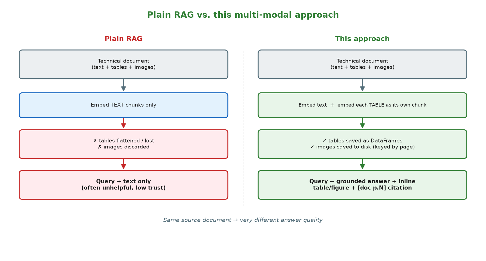
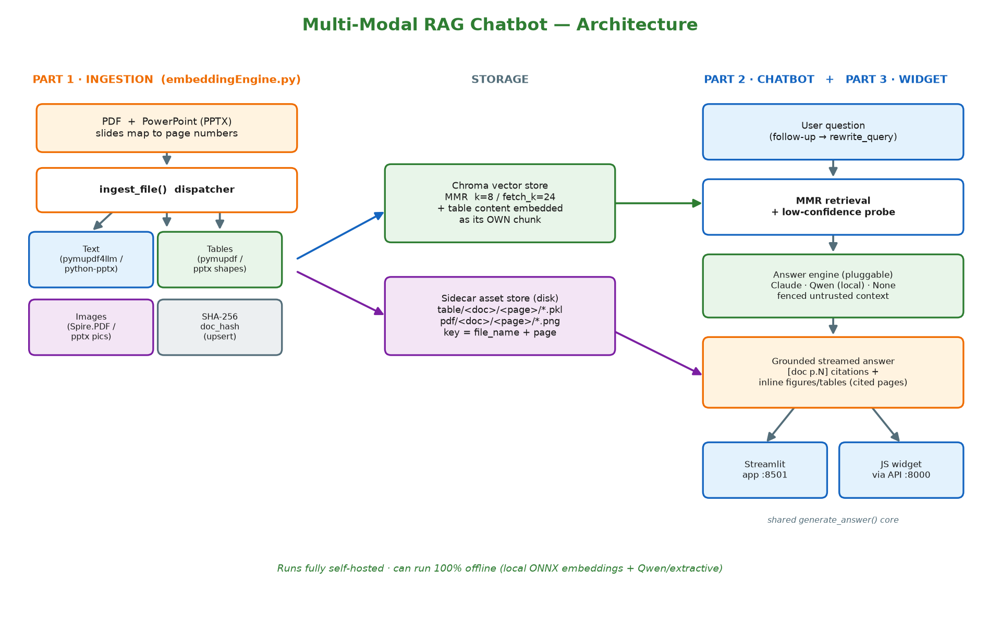
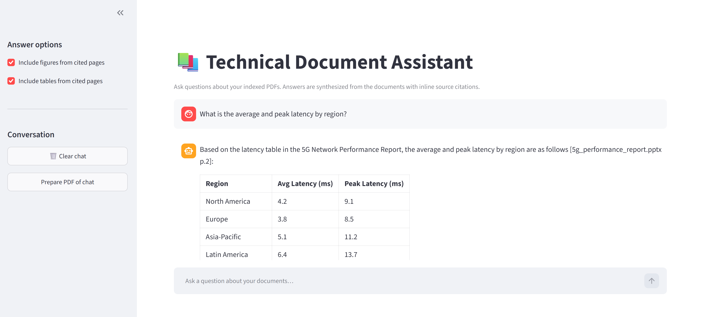
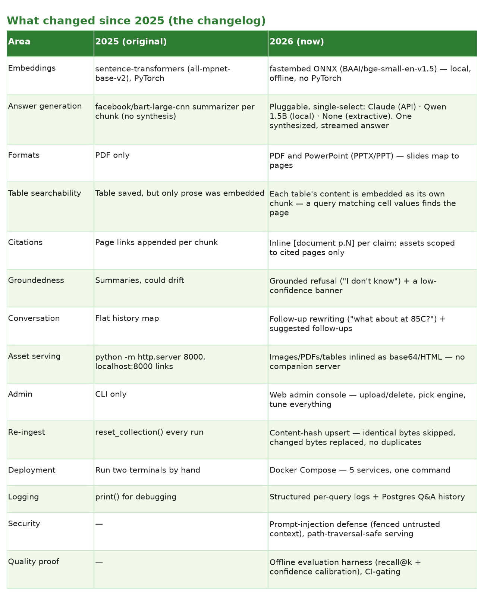
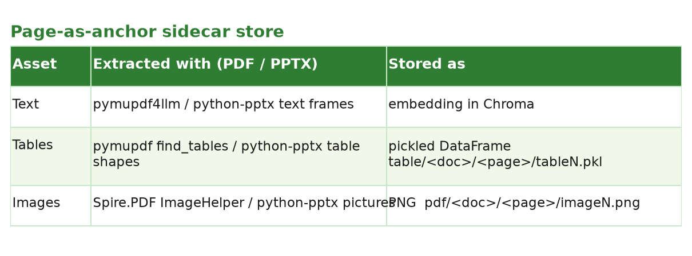
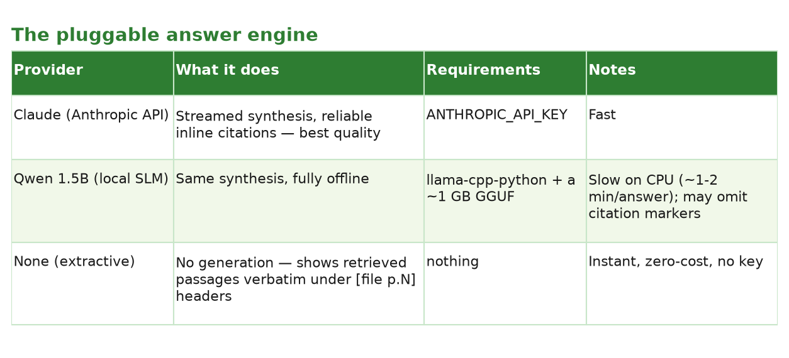
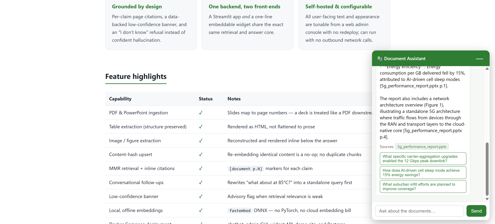
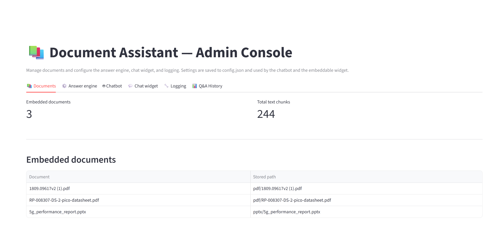
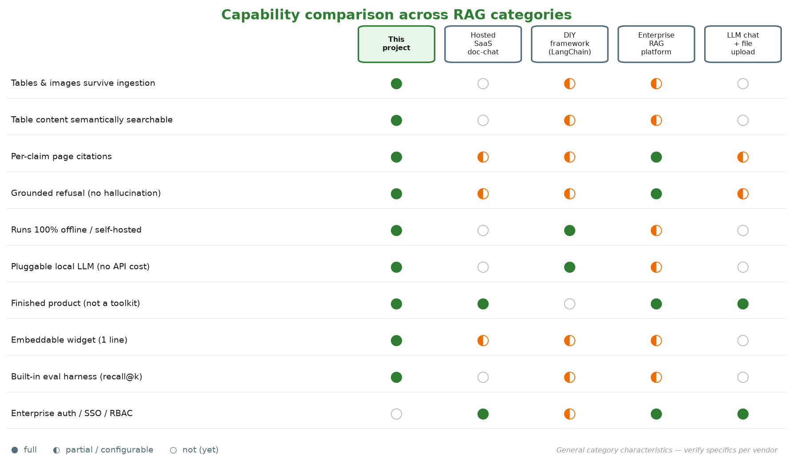

# Using an LLM to retrieve text, tables **and** images in a chatbot with RAG — the multi‑modal, grounded, self‑hosted rewrite

*By Milind Agarwal · ~15 min read*

> **A note on this edition.** I first published this article in January 2025 with a
> simple idea: a technical document is more than text, so a chatbot that answers
> questions about it shouldn't throw away the tables and images during ingestion.
> That core idea still stands — but almost everything *around* it has grown up since.
> What started as two Python files and an `http.server` for avatars is now a
> self‑hostable product: local offline embeddings, a pluggable answer engine (cloud
> **or** a local offline model **or** no model at all), PowerPoint support, grounded
> "I don't know" answers with per‑claim citations, an embeddable one‑line chat widget
> for any website, a Docker Compose stack, Postgres Q&A logging, prompt‑injection
> defense, and an offline evaluation harness. This is the 2026 rewrite. If you read
> the original, you'll recognize the heart of it — it just wears a lot more armor now.

---

## The problem this solves (still the whole point)

In a technical document there is not just text, but images and tables too. Those
images carry important information — architecture diagrams, formulas, flowcharts. The
tables carry specifications, parameters, limits. Very often these images and tables
convey *more* value than the prose around them.

If you build a chatbot to query such documents with a plain RAG approach, you first
create a vector database — embeddings of chunks of the document's **text**. During
that embedding step the image and table information is simply ignored and lost. Even
if you scrape the text out of a table, you lose the table's **structure**. So when
you query that store, all you get back is text — minus the images, minus the tables.
Which is frequently unhelpful to the end user, and doesn't exactly inspire confidence
in the answer.

What if we could retrieve the tables and images too? That was the original ask, and
the approach is the same: be a little **smart during ingestion** (extract and save
the tables/images, keyed by document + page), and use a little **ingenuity at query
time** (reconstruct those assets from metadata and render them inline next to the
answer). Keep the page number and document name attached to everything, so every
answer is **explainable** — the user can jump straight to the source page. That's the
XAI (explainable AI) angle, and it matters more than ever.


*The same source document, two pipelines. Plain RAG (left) embeds only text, so tables
are flattened and images are discarded — the query returns text alone. This approach
(right) keeps the tables and images and even embeds each table's content as its own
searchable chunk, so the answer comes back grounded, with the real table/figure inline
and a page citation.*

What's new is *how well* we can do all of this now, and how production‑ready the whole
thing has become. Let me walk you through it. As before — bear with me to the end. 🙂

---

## The big picture (how it works in three parts)

The original article had two parts: ingestion and the chatbot. There's now a third.

- **Part 1 — Ingestion (`embeddingEngine.py`).** For each **PDF page or PPTX slide**,
  extract text, tables, and images. Embed the text — *and the table content itself* —
  into a Chroma vector store with metadata. Save tables and images to disk keyed by
  document + page. A small dispatcher routes `.pdf` and `.pptx` to the right
  extractor; **slides map to page numbers**, so everything downstream treats a deck
  exactly like a PDF.
- **Part 2 — Chatbot (`chatBOT_engine.py`).** A Streamlit chat app. For a follow‑up
  question it first **rewrites** the question into a standalone query using recent
  history, runs MMR vector search, then **streams a single synthesized answer**
  grounded in the retrieved context with inline `[document p.N]` citations. Based on
  sidebar toggles it also reconstructs and renders the images/tables from the **cited**
  pages, offers a download of each cited source, and suggests clickable follow‑ups.
- **Part 3 — Embeddable widget (`api_server.py` + `widget/`).** The *same* retrieval
  and answer logic (via a shared, UI‑free `generate_answer()`) exposed over an HTTP
  API (FastAPI) plus a one‑line JavaScript widget that drops a floating chat bubble
  onto *any* website.


*The whole pipeline at a glance: ingestion (left) extracts text, tables, and images
and splits them between the Chroma vector store and an on-disk sidecar store; the query
side (right) retrieves, generates a grounded answer with a pluggable engine, and renders
it — the same `generate_answer()` core feeding both the Streamlit app and the embeddable
widget.*


*Ask a question → get a synthesized answer with the **actual table from the source
page** rendered inline, and a `[document p.N]` citation. Most RAG apps would have lost
that table during ingestion.*

---

## What changed since the 2025 article (the honest changelog)

If you only read one section, read this one.



Let's go through the ones that change how you'd *build* this.

---

## Part 1: Ingestion — now smarter, and format‑agnostic

### Local, offline embeddings (goodbye PyTorch)

The original used `SentenceTransformerEmbeddings(model_name="all-mpnet-base-v2")`,
which pulls in PyTorch. The rewrite uses **`fastembed`**, which runs the embedding
model as ONNX — no PyTorch, smaller install, fully offline after a one‑time ~130 MB
model download. The vector store construction is centralized in one function that
ingestion and the chatbot both call, so the embedding model can never drift between
write and read (a classic "empty answers / dimension mismatch" footgun):

```python
from langchain_community.embeddings.fastembed import FastEmbedEmbeddings
from langchain_chroma import Chroma

def get_vectorstore():
    """Return the shared Chroma vector store (same config everywhere)."""
    embedding_function = FastEmbedEmbeddings(model_name="BAAI/bge-small-en-v1.5")
    return Chroma(
        "Project_NAME",
        embedding_function,
        "./chroma_Name",
        collection_metadata={"hnsw:space": "cosine"},
    )
```

### One dispatcher, two formats (PDF *and* PowerPoint)

The original was PDF‑only and noted you *could* extend it. I did. A tiny dispatcher
routes files to the right extractor, and — this is the trick that keeps everything
downstream simple — **a slide's index is treated as its page number**. So a deck
behaves exactly like a PDF everywhere else in the app:

```python
def ingest_file(filepath, vectorstore):
    lower = filepath.lower()
    if lower.endswith(".pdf"):
        return ingest_pdf(filepath, vectorstore)
    if lower.endswith((".pptx", ".ppt")):
        return ingest_pptx(filepath, vectorstore)
    raise ValueError(f"Unsupported file type: {filepath}")
```

`python-pptx` gives us slide text, **native PowerPoint tables**, and **inserted raster
pictures**. (Charts, SmartArt, and vector graphics aren't raster images, so they
aren't extracted — reference them in text, or paste them as a picture if you need them
rendered.)

### The "page‑as‑anchor" sidecar store (unchanged idea, cleaner code)

The join key between embedded text and non‑text assets is still **`file_name` +
`pagenumber`**. Every text chunk is embedded with metadata flags saying whether its
page has an image/table, and the assets live on disk at predictable paths:



### Tables are now semantically searchable (not just stored)

This is one of my favorite upgrades. In 2025 I saved the table to disk but only
embedded the *prose* on the page — so if the answer lived **inside** the table, a
content query might never pull that page. Now each extracted table is flattened to a
label‑rich text form and embedded as its **own** chunk (`contentType: "table"`):

```python
def table_to_text(df):
    """Convert an extracted table to a flat text representation for embedding —
    cell values matter more than exact layout. The first row is the header, so
    we emit lines like '<header>: <value> | <header>: <value>' and a query
    matching cell values retrieves the table's page."""
    rows = df.values.tolist()
    if not rows:
        return ""
    header = [("" if c is None else str(c).replace("\n", " ").strip()) for c in rows[0]]
    lines = ["Table columns: " + " | ".join(h for h in header if h)]
    for row in rows[1:]:
        cells = []
        for idx, val in enumerate(row):
            text = "" if val is None else str(val).replace("\n", " ").strip()
            if not text:
                continue
            label = header[idx] if idx < len(header) and header[idx] else f"col{idx}"
            cells.append(f"{label}: {text}")
        if cells:
            lines.append(" | ".join(cells))
    return "\n".join(lines)
```

So now "what's the VBUS current?" can retrieve a page *because the number is in a
table cell*, not because the prose happened to mention it.

### Re‑embedding is a safe upsert (no more `reset_collection()`)

The original reset the whole collection on every run to avoid duplicates — fine for a
full rebuild, terrible for incrementally adding one document. Now every document is
content‑addressed by a SHA‑256 of its bytes, stored on each chunk as `doc_hash`:

```python
def compute_doc_hash(filepath):
    """A content-addressed ID: SHA-256 of the raw bytes. Same bytes (even under a
    different name) → same hash, so a no-op re-embed is detected and skipped.
    Streamed in blocks so big files don't load fully into memory."""
    h = hashlib.sha256()
    with open(filepath, "rb") as f:
        for block in iter(lambda: f.read(1024 * 1024), b""):
            h.update(block)
    return h.hexdigest()
```

Re‑embedding **identical** content is a no‑op. Re‑embedding **changed** content (or
the same filename with new bytes) deletes the old chunks + stale assets first, then
re‑adds. Duplicates never accumulate — and you never nuke your whole store to add one
file.

---

## Part 2: The chatbot — grounded, conversational, and inline

### From per‑chunk summaries to one synthesized, grounded answer

The 2025 version ran each retrieved chunk through a BART summarizer and concatenated
the results. It was honest about the trade‑off — detailed but not clean. The rewrite
retrieves with **MMR** (`k=8, fetch_k=24, lambda_mult=0.6`, for better recall and
less near‑duplicate noise) and produces **one** synthesized answer that **streams in**,
with inline `[document p.N]` citations for each claim.

Crucially, it's **grounded**: if the retrieved context doesn't contain the answer, the
assistant says it doesn't know rather than inventing something. On such a refusal it
shows **no** source downloads, figures, or follow‑ups (those would reflect off‑topic
chunks, not your question). A **low‑confidence banner** appears when the best retrieval
score falls below a configurable threshold (default **0.63**, which — nice touch — is
backed by the evaluation harness, not guessed).

### The answer engine is pluggable (and can be *no* engine)

This is the biggest conceptual change. The answer backend is **single‑select**, chosen
in the admin GUI and stored in `config.json`. The chatbot reads it once per session and
uses it transparently — chat users never see or pick the engine:



And there's an **auto‑fallback**: if the selected provider isn't actually available at
runtime (missing key, missing GGUF), it silently falls back to extractive so the app
never breaks. A fresh clone defaults to `none` and runs with no key and no model
download. This means the whole thing can run **100% offline** (local embeddings +
Qwen or extractive = no outbound calls) — which matters a lot for confidential docs.

### Follow‑ups that actually understand context

Ask "What's the Pico's VBUS current?" then "What about at 85°C?" — the second question
is meaningless to a retriever on its own. So before searching, the app **rewrites** it
into a standalone query using recent history:

```python
def rewrite_query(question, messages, provider):
    """Rewrite a context-dependent follow-up into a standalone retrieval query
    using recent chat history. No-ops for the first turn, clearly self-contained
    questions, or extractive mode."""
    if provider == "none":
        return question
    if not _needs_rewrite(question, messages):
        return question
    history = _recent_history_text(messages)
    if not history:
        return question
    system = (
        "You rewrite a user's latest message into a single standalone search "
        "query by resolving pronouns and references using the conversation. "
        "Output ONLY the rewritten query as one line — no preamble, no quotes. "
        "If the message is already self-contained, output it unchanged."
    )
    user = f"Conversation:\n{history}\n\nLatest message: {question}\n\nStandalone query:"
    rewritten = _complete(system, user, provider, max_tokens=80)
    lines = [ln.strip() for ln in (rewritten or "").splitlines() if ln.strip()]
    rewritten = lines[0].strip('"').strip() if lines else ""
    if not rewritten or len(rewritten) > 300:   # guard against junk rewrites
        return question
    return rewritten
```

The app also suggests clickable follow‑up questions under each answer (suppressed when
the question was out of context or low‑confidence).

### Assets render inline — no more companion web server

In 2025 the templates linked to `http://localhost:8000/AI.png` and friends, so you had
to run `python -m http.server 8000` in a second terminal just to see avatars and
download links. Now **images, source PDFs, and tables are inlined directly into the
page** — images and PDFs as base64 `data:` URIs, tables as HTML — so **no static file
server is needed**. One service runs the whole chatbot. (Very large source PDFs >8 MB
are shown as a plain filename label instead of an inline download, to keep the page
light.) And attribution is scoped to the pages the answer **actually cited**, so a
chunk retrieval pulled in but the answer didn't use won't leave a stray asset behind.

There's also a **"Prepare PDF of chat"** button that exports the whole conversation —
images and tables included — via `xhtml2pdf`.

---

## Part 3 (new): An embeddable chat widget for any website

The same RAG backend is now exposed as a one‑line embeddable widget. A site owner adds
a single tag before `</body>`:

```html
<script src="https://YOUR_HOST/widget/widget.js"
        data-api="https://YOUR_HOST/api"></script>
```

That drops a floating chat bubble on the page which talks to a **FastAPI** backend
(`POST /api/chat`, `GET /api/health`, `GET /api/source/{name}`) and renders answers
with clickable source citations and suggested follow‑ups. The widget and the Streamlit
app share the **exact same** `generate_answer()` core — there's no second
implementation to keep in sync.



The `/api/source/{name}` endpoint only serves whitelisted document types by basename,
with path‑traversal protection. A demo site (a fake third‑party page on a different
origin) is included to prove the cross‑origin embed works.

> **Honest caveat (and my top roadmap item):** the API and Streamlit app are currently
> **open and unauthenticated**, with open CORS. That's fine for a local demo, but
> before any public or multi‑user deployment you must add auth, an origin allowlist,
> rate limiting, and request‑size caps — especially for internal/confidential material.

---

## Security: defending a RAG app from the documents themselves

A RAG app pastes retrieved document text straight into the LLM prompt. So a poisoned
document could carry text like *"ignore previous instructions and…"* — an **indirect
prompt injection**. The rewrite defends against this by fencing the retrieved context
as untrusted data and establishing an instruction hierarchy in the system prompt
(everything inside the fence is *data to quote and cite*, never instructions to obey):

```python
def _fence_context(context):
    """Wrap retrieved context in untrusted-data delimiters referenced by the
    system prompt. Any occurrence of the delimiter tokens *inside* the document
    is stripped first, so a malicious document can't forge the closing marker to
    escape the data region and inject trusted instructions."""
    safe = (context or "").replace(_CTX_BEGIN, "").replace(_CTX_END, "")
    return f"{_CTX_BEGIN}\n{safe}\n{_CTX_END}"
```

The defense applies to both generative providers (extractive mode has no LLM, so it's
inherently immune), and it's regression‑tested. Output rendering is injection‑safe too:
the widget inserts text via `textContent` (HTML‑escaped), and the Streamlit app only
uses `unsafe_allow_html` for its *own* figure/table HTML built from local files — never
for model output.

---

## Running it (so much simpler now)

### One command, locally

```bash
python3 -m venv .venv && source .venv/bin/activate
pip install --upgrade pip && pip install -r requirements.txt   # there IS a requirements.txt now
cp .env.example .env            # add ANTHROPIC_API_KEY only if you want Claude
mkdir -p pdf pptx && cp /path/to/*.pdf pdf/ && cp /path/to/*.pptx pptx/
python embeddingEngine.py       # build store + extract images/tables
streamlit run chatBOT_engine.py # → http://localhost:8501
```

No second terminal for a file server. No PyTorch. No API key unless you opt into Claude.

### The whole stack in Docker

```bash
cp .env.example .env
docker compose up --build
```

That brings up **five services**: the chatbot (`:8501`), the admin GUI (`:8502`), the
widget API (`:8000`), a demo site (`:9000`), and a Postgres `db` for Q&A logging. Config
lives in a mounted `config.json`, so you can retune the app without a redeploy.

### A web admin console (no CLI required)

Upload or delete documents (with a pages/tables/images summary), pick the answer engine,
tune the confidence threshold, edit every piece of user‑facing text, set the widget
theme, configure logging, and browse the Q&A history — all from a tabbed Streamlit UI.



---

## Proving it works: an offline evaluation harness

I added something the original lacked entirely — a way to **measure** retrieval quality
with evidence, so I can catch regressions and tune settings instead of guessing. It's
**embedding‑only (no LLM calls, no API cost)** and drives the same functions the chatbot
uses:

```bash
python -m tests.eval.run              # human-readable report + pass/fail
python -m tests.eval.run --json out.json
```

It reports two things:

- **Retrieval recall@k** — for each ground‑truth question, is the expected page in the
  top‑k retrieved chunks? It exits non‑zero below a `recall_floor`, so retrieval
  regressions are caught in CI before users see them.
- **Confidence calibration** — the score distributions for in‑corpus vs off‑topic
  questions, and a **suggested `low_confidence_threshold`** sitting in the gap between
  them. (That's where the 0.63 default came from: in‑corpus min ≈0.65, off‑topic max
  ≈0.61.)

The reference set is plain JSON of human‑asserted question→page pairs, and it adapts to
a changing store — a question whose document isn't currently embedded is skipped, not
failed.

---

## Observability: you can finally see what the bot did

Every answered question logs **one structured line** (provider, retrieval breadth, best
relevance score, low‑confidence/refusal flags, source count, latency), and — for both
the chatbot and the widget — a row in a Postgres `qa_log` table (`asked_at`, `source`,
`question`, `answer`, `provider`, `best_score`, `sources` as JSONB, `latency_ms`, …).
Logging is **fail‑safe**: if Postgres is unreachable, answering still works and the
write silently no‑ops, failing fast so it never adds latency. The admin console's Q&A
History tab gives you stats, filters, a read‑only table, CSV export, and retention
purge.

---

## Honest limitations (the questions a sharp reader will ask)

- **No authentication yet.** The app and widget API are open — top‑priority before any
  public/multi‑user deployment.
- **The widget is text + citations only** today — no streaming, no inline figures/tables
  (the Streamlit app has all three).
- **No OCR** — scanned/image‑only PDFs aren't text‑extracted.
- **Non‑raster graphics** (charts, SmartArt, vector art) aren't extracted as images.
- **Local Qwen is slow on CPU** (~1–2 min/answer) and may omit inline citation markers —
  use Claude when speed and strict citations matter.

---

## How it compares to other RAG approaches

People reasonably ask: why not just use a hosted upload-and-chat SaaS, assemble
something with LangChain yourself, buy an enterprise RAG platform, or paste the PDF into
a general LLM chat? Each of those is a legitimate choice — they just optimize for
different things. Here's the honest positioning across the capabilities this project
leads with (these are *general category* characteristics; verify specifics against any
given vendor's current docs):



The short version:

- **vs. hosted SaaS doc-chat** — this wins on data residency (fully self-hosted, can be
  offline), table/figure fidelity (most SaaS flatten to text), no per-seat/token bill,
  and a white-labelable widget. They win on turnkey auth/SSO and multi-tenant user
  management out of the box — which is still a roadmap item here.
- **vs. a DIY framework stack** — this is a *finished, runnable product* (ingestion +
  chat + admin GUI + widget + Docker + eval harness), not a toolkit you assemble. They
  win on unlimited flexibility and a huge connector ecosystem.
- **vs. an enterprise RAG platform** — this wins on footprint, cost, transparency (open,
  inspectable code and prompts), and offline capability. They win on enterprise
  auth/RBAC, SharePoint/Confluence connectors, compliance certs, SLAs, and scale/HA.
- **vs. general LLM chat with file upload** — this wins on a persistent indexed corpus
  (no re-uploading per chat), exact-page attribution, rendered tables/figures, and
  grounded refusal. They win on general reasoning breadth and zero setup for a one-off.

The one row where this project is honestly behind is **enterprise auth** — it's the top
of my roadmap, and I'd rather state it plainly than hide it.

---

## Why bother keeping tables and images?

Same reason as 2025, and it's held up: for technical readers, the *artifact* often **is**
the answer. A spec table or an architecture diagram tells them what they need far faster
than a paragraph summarizing it — and seeing the real table, on the real cited page,
builds the trust that a bare generated sentence never will. What's new is that the whole
thing is now grounded (it refuses when it doesn't know), self‑hostable and offline‑capable
(nothing has to leave your machine), embeddable anywhere, and provable (the eval harness).

If you read the original: thank you, and the heart of it is unchanged. It just grew up.

---

## Toolset (2026)

- **Embeddings:** `fastembed` ONNX, `BAAI/bge-small-en-v1.5` (local, offline, no PyTorch)
- **Answer engine:** Claude (API) · Qwen 1.5B GGUF via `llama-cpp-python` (local) · None (extractive)
- **Retrieval / store:** Chroma with MMR (`k=8, fetch_k=24, lambda_mult=0.6`)
- **PDF:** `pymupdf4llm` (text), `pymupdf`/`fitz` (tables), `Spire.PDF` (images)
- **PPTX:** `python-pptx` (text, native tables, pictures)
- **UI:** Streamlit chat primitives · **Widget:** vanilla JS · **API:** FastAPI
- **Chat‑to‑PDF:** `xhtml2pdf` · **Q&A logging:** Postgres via `psycopg` 3
- **Deployment:** Docker Compose (5 services)

## References

- Streamlit — https://docs.streamlit.io/
- LangChain — https://python.langchain.com/docs/introduction/
- Chroma — https://www.trychroma.com/
- PyMuPDF / pymupdf4llm — https://pymupdf.readthedocs.io/en/latest/pymupdf4llm/index.html
- fastembed — https://github.com/qdrant/fastembed
- llama.cpp / llama-cpp-python — https://github.com/abetlen/llama-cpp-python

*GitHub: Naina2023/ChatBOT*
